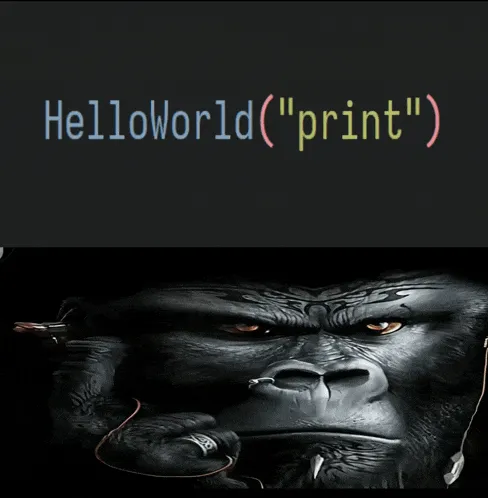

 

  

  

<h3>sobre mim</h3>

  Desenvolvedor web focado em criar interfaces
   
  e transformar ideias em projetos reais.
   
  Uso IA no desenvolvimento, mas ainda preciso
   
  entender o que ela resolveu fazer.

 

<pre>
$ codex
limite atingido

$ claude
contexto restante: 2%

$ git status
modified: tudo
</pre>

 

  

ultimo commit: era so uma alteracao pequena

 

