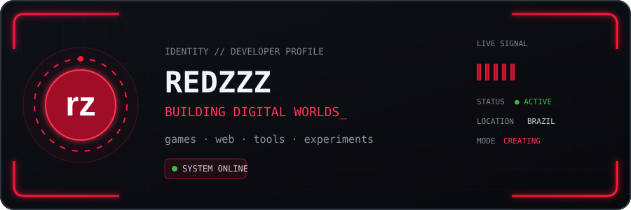
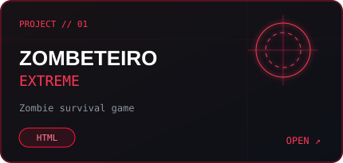
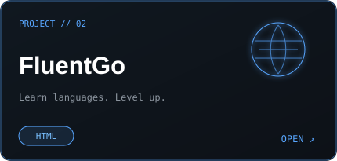
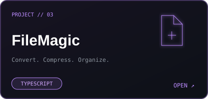
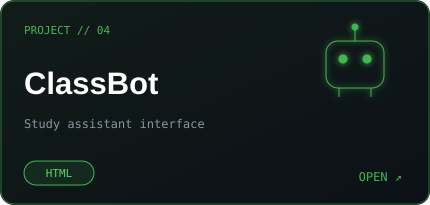

<pre style="background: transparent; border: none; padding: 0; margin: 0; font-family: monospace;">
    ██████╗ ███████╗██████╗ ███████╗███████╗███████╗
    ██╔══██╗██╔════╝██╔══██╗╚══███╔╝╚══███╔╝╚══███╔╝
    ██████╔╝█████╗  ██║  ██║   ███╔╝   ███╔╝   ███╔╝ 
    ██╔══██╗██╔══╝  ██║  ██║  ███╔╝   ███╔╝   ███╔╝  
    ██║  ██║███████╗██████╔╝ ███████╗███████╗███████╗
    ╚═╝  ╚═╝╚══════╝╚═════╝  ╚══════╝╚══════╝╚══════╝
</pre>

  

  

  

 

  

  

  

  
  

  
  

  

  

